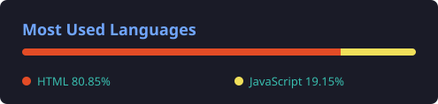

<a href="README.md">Bahasa Indonesia</a> | <a href="README.en.md">English</a>

### Hi, I'm Riel (`andrian219`)

I am currently learning programming and developing Android applications along with simple web projects.

---

**Projects:**
- **[PDFCrate](https://github.com/andrian219/PDFCrate)** — Free PDF tools that run entirely in your browser.
- **RielTL Android** — Native Android application version of RielTL.
- **[SiapUjian](https://github.com/andrian219/SiapUjian)** — Free online school exam application for teachers.

---

### Currently Learning

---

